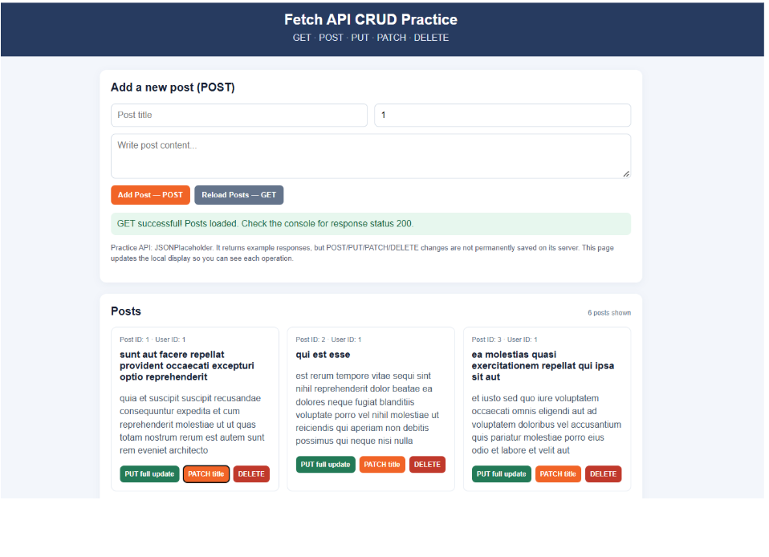

# JavaScript Basics - Assignment 11
Fetch API, HTTP Methods & API-Based Projects

## Topics Covered: 
Fetch API, GET, POST, PUT, PATCH, DELETE, HTTP status codes, JSON, response.json(), response.ok, async/await, Promise chaining, error handling

## Important Instructions
- Read each scenario carefully and complete all listed requirements.
- Create separate HTML, CSS, and/or JavaScript files for each question, as applicable.
- Use clean, properly indented code and meaningful variable names. Do not use JavaScript frameworks or external libraries.
- Show loading, success, and error messages where appropriate.
- Check response status and handle failed requests. Fetch does not automatically reject for HTTP errors such as 404; check response.ok.
- Use Fetch with .then() chaining or async/await as specified.

## Submission Instructions
- Submit through a link to your GitHub repository.        
- Keep a separate file for each question, including all required HTML and JavaScript files.       
- Push all final files to GitHub before submitting the link.      
- Make sure the repository is accessible to the instructor.            

### Question 1 –  Fetch API CRUD Practice Page
Re-create the webpage shown below as closely as possible. Use HTML and CSS for the layout and the Fetch API to implement post operations.   
Reference Image:                 

### Requirements        
- Create a header titled “Fetch API CRUD Practice” and show `GET, POST, PUT, PATCH, DELETE` underneath it.           
- Create an Add Post form with fields for post title, user ID, and post content. Include an Add Post button and a Reload Posts button.     
- On page load and when Reload Posts is clicked, use GET to load the first six posts from `https://jsonplaceholder.typicode.com/posts?_limit=6.`         
- Display each post in a card with its post ID, user ID, title, and body.               
- On form submission, send POST to `https://jsonplaceholder.typicode.com/posts`, using a Content-Type header and `JSON.stringify()`.     
- Add controls to each post card for updating the full post with PUT, updating only the title or body with PATCH, and deleting the post with DELETE.                
- Show success/error messages and log each response status code. Handle loading and non-success HTTP responses.           
- JSONPlaceholder is a practice API: POST/PUT/PATCH/DELETE return example responses, but changes are not permanently stored. Update the local page state so users can see each operation’s result.

**Suggested files:** Q1_crud.html, Q1_crud.css, Q1_crud.js

### Question 2 – Product Explorer
You are creating a simple product explorer for an online store.      
`API: https://dummyjson.com/products`
- Use GET to request the product data and display the response status code in the console.
- Convert the response body to JSON and access the products array.
- Log the brand of the first product.
- Display at least six products as cards containing the title, brand, price, and thumbnail image when available.
- Show a loading message while the products are being fetched.
- Use `.then()` chaining and handle errors with `.catch()`.   
- If the response is not successful, show an appropriate error message.   

**Suggested files:** Q2_products.html, Q2_products.css, Q2_products.js


### Question 3 – Recipe Finder
Create a recipe browsing page for someone who wants to discover meals and decide what to cook.
`API: https://dummyjson.com/recipes  `
- Use Fetch to retrieve recipes from the API.  
- Display at least six recipes as cards containing the recipe name, cuisine, image, and preparation time when available.  
- When a recipe card is selected or a details button is clicked, display its ingredients in a readable list.  
- Display the HTTP status code and a loading message while the request runs.  
- Use async/await, try/catch, and check response.ok so the page shows a helpful message if the request fails.  

**Suggested files:** Q3_recipes.html, Q3_recipes.css, Q3_recipes.js


### Question 4 – API Request Practice: Create and Update a Post
A learning platform lets a user submit an announcement and then make changes to it. Use JSONPlaceholder to practice sending data to an API.
`Base URL: https://jsonplaceholder.typicode.com/posts`

- Create a simple form with fields for title, content, and user ID.
- Submit the form using POST and display the returned response, including its status code and returned ID.
- Send a PUT request to `/posts/1` with a complete post object to replace the record representation.
- Send a PATCH request to `/posts/1` to update only one field, such as the title.
- Send a DELETE request to `/posts/1` and display the response status.
- Use async/await and try/catch. Create a reusable request helper that accepts a URL, method, and optional body.
- Explain in a code comment why request objects need `JSON.stringify()` and an appropriate Content-Type header.

## Suggested Project Structure
```
Assignment-11/
  Q1_crud.html / Q1_crud.css / Q1_crud.js
  Q2_products.html / Q2_products.css / Q2_products.js
  Q3_recipes.html / Q3_recipes.css / Q3_recipes.js
  Q4_postRequests.html / Q4_postRequests.css / Q4_postRequests.js

```

## Final Submission Checklist

■ Each question is saved separately.    
■ Array and object destructuring tasks are completed.    
■ Missing data and renamed properties are handled where required.     
■ Arrays and objects are copied or combined without changing the originals where required.    
■ Named and default exports/imports are demonstrated.           
■ Module files use correct file paths and load through a local development server.    
■ All files are pushed to GitHub.             
■ GitHub repository link is ready to submit.             

### Analyze the data, choose the right ES6+ feature, and keep your code reusable. Happy Coding!
